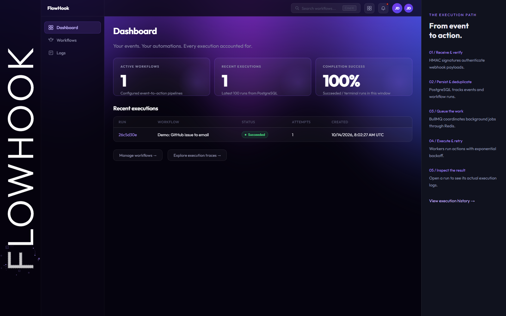
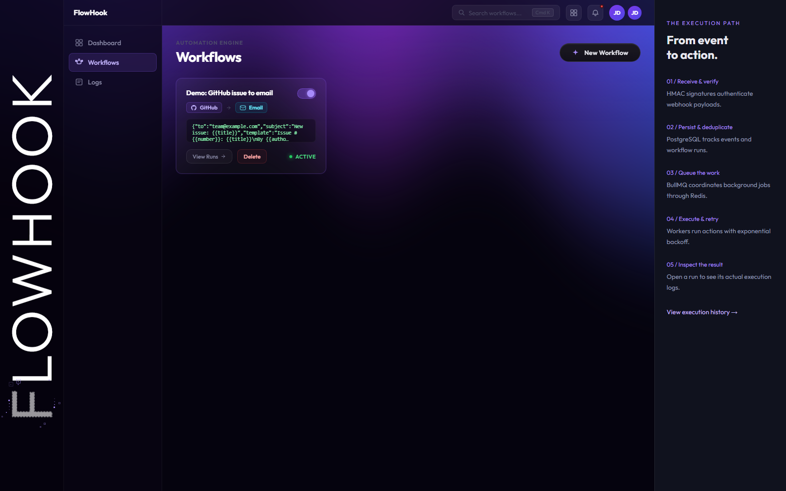
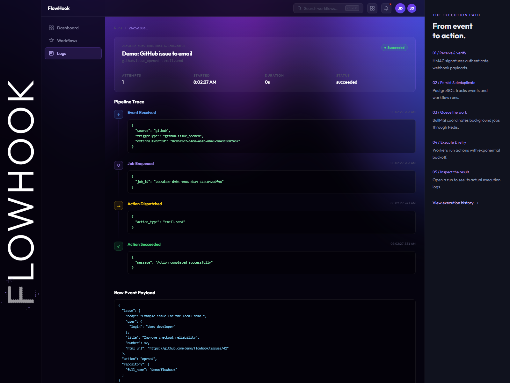
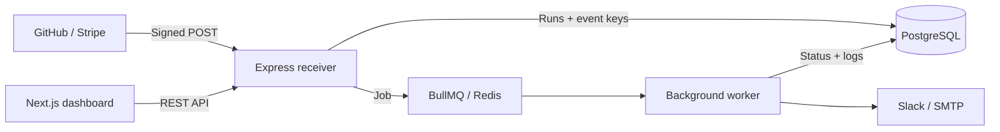
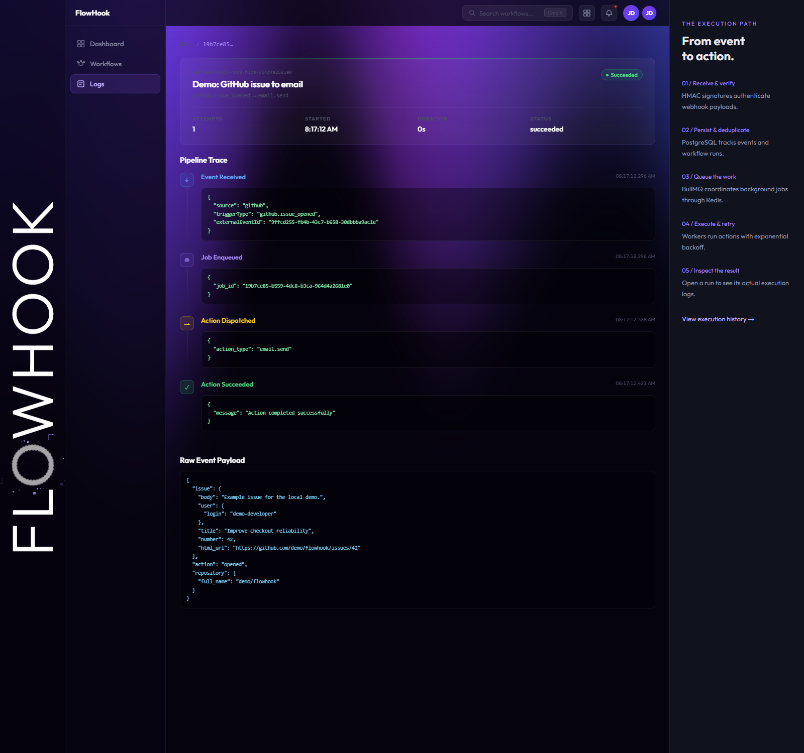

<div align="center">


**A webhook automation engine built with TypeScript, PostgreSQL and Redis.**

Receive signed events. Queue background actions. Inspect every execution.

**Created by [Parardha Dhar](https://github.com/parardhadhar)**


[Try it locally](#run-the-complete-local-demo) · [Architecture](#architecture) · [Engineering decisions](#engineering-decisions)

</div>

## What it does

FlowHook connects a trigger in one service to an action in another. A GitHub issue can generate an email; a successful Stripe payment can generate a Slack notification. The receiver verifies the event, records a run, and queues background execution. The dashboard exposes workflows, run history, statuses, and step-level logs.

This is a learning and portfolio project with a runnable local demo. It is not a hosted production service.

## Run the complete local demo

Prerequisite: Docker Desktop with a running Linux container engine. No real GitHub, Stripe, Slack, or email account is required for the demo.

```bash
git clone https://github.com/parardhadhar/FlowHookCore.git
cd FlowHookCore
docker compose up --build -d
docker compose exec api npm run demo
```

If an existing local API is using port 3000, stop it first with Ctrl+C. The first build downloads dependencies and container images.

| Open | Address |
|---|---|
| Dashboard | http://localhost:3001 |
| Workflow editor | http://localhost:3001/workflows |
| Execution history | http://localhost:3001/runs |
| Captured demo emails | http://localhost:8025 |
| API health | http://localhost:3000/health |

The demo creates an email workflow, delivers a signed GitHub issue event **twice**, including its optional AI digest, checks that only one run is created, waits for worker success, and verifies an execution log. Mailpit captures the real SMTP message locally; it does not send email to an external recipient. Run the command again to generate another execution.

```bash
docker compose logs -f api worker
docker compose exec redis redis-cli ping
docker compose down
```

Compose keeps PostgreSQL inside the container network, so it can coexist with a Windows PostgreSQL installation. Named volumes preserve database and queue data across container restarts. Included credentials are local demo values; personal `.env` files are excluded from Git and Docker build contexts.

## Dashboard preview

Actual screenshots from the local Docker demo, after processing a signed GitHub webhook.



<details>
<summary>Workflow editor and execution trace</summary>





</details>

## Architecture



## Features

- Stripe HMAC-SHA256 verification with a five-minute timestamp tolerance.
- GitHub HMAC-SHA256 verification against the original request body.
- Active trigger-to-action workflows with creation, pause/resume, and deletion.
- Per-event, per-workflow duplicate detection using a PostgreSQL composite key.
- Separate worker process with concurrency 5 and five total attempts.
- Exponential retry delays: 2, 4, 8, and 16 seconds before subsequent attempts.
- Exhausted runs marked `dead_letter` and exposed in the dashboard.
- Slack messages and SMTP emails with event-variable interpolation.
- Execution history and persisted step logs.
- Docker Compose demo with PostgreSQL, Redis, API, worker, dashboard, and Mailpit.



## AI issue digests

Enable `"ai_summary": true` in a GitHub issue workflow and include `{{ai_summary}}` in the email or Slack template. The worker calls **Groq**, using **Qwen 3.8 27B** by default, to produce a short engineering digest. The provider and summary appear in the persisted `ai_summary` execution step.

```json
{
  "to": "team@example.com",
  "subject": "New issue: {{title}}",
  "ai_summary": true,
  "template": "{{ai_summary}}\n\n{{url}}"
}
```

For Docker, create a local root `.env` containing `GROQ_API_KEY=your_key`, then recreate the worker with `docker compose up -d worker`. Set `GROQ_MODEL` to override the model. Native development reads these values from `api/.env`. Keys are excluded from Git and Docker build contexts.

Groq offers a [Free plan with rate limits](https://console.groq.com/docs/rate-limits); use that plan for a portfolio demo. No paid-plan upgrade is required by this project. Model availability and account quotas may change.

Requests use bounded issue text, a token cap, and an eight-second timeout. Missing keys, rate limits, unavailable models, and malformed responses produce a deterministic issue excerpt labeled `fallback`, not fabricated AI output. Saved summaries are reused across action retries. Issue text is treated as untrusted data, and only the issue title/body is submitted to Groq. Model summaries remain untrusted text and cannot execute tools or change workflows.

The demo now enables the AI option and verifies the saved summary step. With no key it checks the fallback; with a configured key it exercises the provider. Unit tests cover provider responses, rate limits, network errors, malformed output, and the no-key path.

## Engineering decisions

**Separate ingestion from execution.** An external action can be slow or unavailable. Queuing lets the receiver acknowledge accepted events while workers handle actions and retries separately.

**PostgreSQL and Redis have different roles.** PostgreSQL stores workflows and execution records. BullMQ uses Redis for scheduling and coordination.

**Commit before publishing a job.** Workers must be able to see a run before processing it. Runs are committed before queue publication.

**Duplicate ingestion is not exactly-once delivery.** The event key prevents a repeated webhook from creating another run for the same workflow. An external action can still repeat if the worker crashes after sending it but before saving success.

## Scope and limitations

This version supports one action per workflow. It does not implement authentication, multi-tenancy, or production secret management. Management endpoints are intended for trusted local use; Compose binds public ports to loopback.

Database persistence and Redis queue publication are not atomic. A crash between them can leave a persisted run without a queued job; a transactional outbox and reconciliation process are future work. `dead_letter` is a persisted status, not a separate queue with replay controls. Automatic retries apply to job execution, not webhook ingestion failures.

Dashboard figures are derived from the latest 100 runs; they are not lifetime totals or uptime measurements. No throughput or latency benchmark is claimed.

## Development and validation

```bash
cd api
npm ci
npm run build
npm test

cd ../dashboard
npm ci
npm run build
```

Thirteen signature and AI adapter tests cover valid requests, invalid signatures, tampered bodies, stale Stripe timestamps, and incorrect GitHub secrets. The Docker demo exercises workflow creation, raw-body signature verification, duplicate delivery, worker execution, and execution logs.

For native development, copy `api/.env.example` to `api/.env`, configure PostgreSQL/Redis/SMTP, and run `npm run dev` and `npm run dev:worker` in separate API terminals. Start the dashboard with `npm run dev -- -p 3001`.

## Repository map

```text
api/src/index.ts           Express bootstrap and middleware
api/src/webhooks/          Signature verification and ingestion
api/src/routes/            Workflow and run REST endpoints
api/src/db/                PostgreSQL connection and schema
api/src/queue.ts           BullMQ job policy
api/src/worker.ts          Background action execution
api/src/adapters/          Slack and email integrations
api/scripts/demo.cjs      Repeatable signed-event demo
api/tests/                Signature tests
dashboard/                Next.js workflow and execution UI
docker-compose.yml        Complete local demo environment
```

## API

| Method | Endpoint | Purpose |
|---|---|---|
| GET | `/health` | API liveness |
| GET | `/api/info` | Project metadata |
| POST | `/webhooks/github` | Signed GitHub issue events |
| POST | `/webhooks/stripe` | Signed Stripe payment events |
| GET / POST | `/api/workflows` | List / create workflows |
| PATCH | `/api/workflows/:id/toggle` | Pause / resume |
| DELETE | `/api/workflows/:id` | Delete workflow |
| GET | `/api/workflows/:id/runs` | Workflow executions |
| GET | `/api/workflows/runs` | Latest 100 executions |
| GET | `/api/workflows/runs/:runId/logs` | Execution trace |
